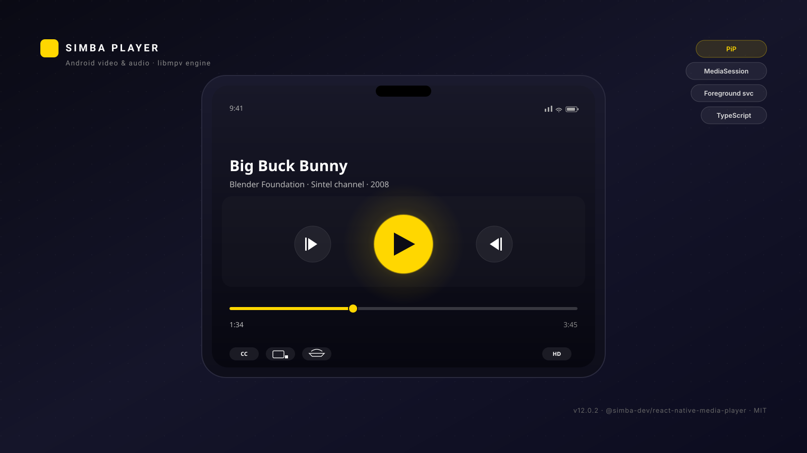

# @simba-dev/react-native-media-player

React Native video and audio playback for Android, backed by [libmpv](https://mpv.io/).
One engine for both lanes: a MediaSession and a foreground service for audio, Picture-in-Picture for video.

The library renders the picture and exposes state and commands. It draws no controls of its own — your app supplies the chrome.



<p align="left">
  <a href="https://www.npmjs.com/package/@simba-dev/react-native-media-player"></a>
  <a href="https://github.com/pavalep/react-native-media-player/releases"></a>
  <a href="./LICENSE"></a>
  <a href="https://www.npmjs.com/package/@simba-dev/react-native-media-player"></a>
  <a href="https://github.com/pavalep/react-native-media-player/tags"></a>
  <a href="https://github.com/sponsors/pavalep"></a>
  <a href="https://buymeacoffee.com/pavalep"></a>
  <a href="https://github.com/pavalep/react-native-media-player/actions/workflows/ci.yml"></a>
  <a href="https://github.com/pavalep/react-native-media-player/actions/workflows/release.yml"></a>
</p>

<p align="left">
  <a href="https://github.com/pavalep/react-native-media-player/releases">Releases</a>
  &nbsp;·&nbsp;
  <a href="https://github.com/pavalep/react-native-media-player/blob/main/CHANGELOG.md">CHANGELOG</a>
  &nbsp;·&nbsp;
  <a href="https://www.npmjs.com/package/@simba-dev/react-native-media-player">npm package</a>
  &nbsp;·&nbsp;
  <a href="https://github.com/pavalep/react-native-media-player/tags">Tags</a>
</p>

## Contents

1. [What this is](#what-this-is)
2. [What this is not](#what-this-is-not)
3. [Requirements](#requirements)
4. [Installation](#installation)
5. [Consumer setup](#consumer-setup)
6. [Quick start](#quick-start)
7. [Controls](#controls)
8. [Configuration](#configuration)
9. [Picture-in-Picture](#picture-in-picture)
10. [Background audio](#background-audio)
11. [Theming](#theming)
12. [API reference](#api-reference)
13. [Troubleshooting](#troubleshooting)
14. [Limitations](#limitations)
15. [Contributing](#contributing)
16. [License](#license)

---

## What this is

A playback engine for React Native on Android, backed by libmpv. One engine serves both audio and
video, and the two lanes meet in the same bridge:

- **One Activity.** The library declares no Activity. Playback happens inside the launcher Activity
  your app already has; the video picture is `<SimbaVideo />` in your React tree.
- **One engine for audio and video.** Audio files play through the same libmpv instance with no
  surface attached, so there is no second player to maintain.
- **MediaSession and foreground service.** Title, artist and album reach the lock screen and the
  media notification; play, pause, stop, next, previous and seek are advertised to the session, so
  headset buttons and Bluetooth controls work.
- **Picture-in-Picture.** Manual entry on demand, and auto-enter on leave on every Android
  version - your app performs the entry itself, after taking its own chrome off screen.
- **Typed surface.** Config, state, commands and hooks are all typed.

## What this is not

- **Not a drop-in replacement for `react-native-video`, `expo-av` or `react-native-track-player`.**
  Those expose a component you hand a `source` to. This one has a different shape: a provider, a
  `<SimbaVideo />` picture, and `usePlayer()` for state and commands. There is no `<Video source={…} />`
  here, and no adapter will make one.
- **Not a control surface.** Since 2.0.0 the library ships no controls at all — see
  [Controls](#controls).
- **Not iOS.** `react-native.config.js` sets `ios: null`; there is no iOS implementation.
- **Not a legacy-bridge library.** The native package is a `TurboReactPackage`, so the New
  Architecture is required (`newArchEnabled=true`).
- **Not a "clone the repo and build it" package.** The prebuilt libmpv binaries are downloaded at
  install time — see [Installation](#installation).

## Requirements

| | |
| --- | --- |
| React Native | `>= 0.76.0` (peer dependency) |
| React | `>= 18.0.0` (peer dependency) |
| Android | API 24+ (Android 7.0). PiP entry calls `Activity.enterPictureInPictureMode()`, which was added in API 24. `compileSdk` and `targetSdk` are inherited from your app's `rootProject.ext` — the library does not pin them. |
| JDK | 17. The library's Kotlin `jvmTarget` is 17. |
| New Architecture | Required. `PlayerPackage` extends `TurboReactPackage`. |

## Installation

```bash
npm install @simba-dev/react-native-media-player
```

Autolinking handles the rest: the shipped `react-native.config.js` tells React Native's CLI where
the Android module lives, so `com.simba.player.PlayerPackage` is registered in your
`MainApplication.kt` on the next build.

### The native binaries

The `postinstall` script (`scripts/download-native.js`) downloads the prebuilt native libraries
(libmpv and friends) from the matching GitHub release, verifies the archive's SHA-256 and extracts
it into `android/src/main/jniLibs/<abi>/` inside the installed package. Four ABIs are published:
`arm64-v8a`, `armeabi-v7a`, `x86`, `x86_64`.

The script is idempotent — if the binaries are already in place it exits without a network call,
so re-running `npm install` is safe. Set `SKIP_DOWNLOAD_NATIVE=1` to skip the download entirely
(this is what the release workflow does, because CI builds the binaries itself).

## Consumer setup

The package's own manifest declares a foreground service and the media button receiver. It
declares no Activity: playback happens in the Activity your app already has.

The Picture-in-Picture action receiver is registered by this package at runtime, once per
process. You do not register it, and you must not: a second registration would deliver every
PiP action twice, and a play/pause that toggles twice does nothing at all.


### Picture-in-Picture

Your launcher Activity has to opt in:

```xml
<!-- android/app/src/main/AndroidManifest.xml -->
<activity
    android:name=".MainActivity"
    android:configChanges="orientation|screenSize|screenLayout|keyboardHidden|navigation"
    android:launchMode="singleTask"
    android:supportsPictureInPicture="true"
    android:resizeableActivity="true"
    android:theme="@style/AppTheme"
    android:exported="true">
    <intent-filter>
        <action android:name="android.intent.action.MAIN" />
        <category android:name="android.intent.category.LAUNCHER" />
    </intent-filter>
</activity>
```

`resizeableActivity="true"` is not optional. An Activity that is not resizeable cannot enter
Picture-in-Picture.

If `config.pip.autoEnterOnLeave` is on, the Activity also has to hand the leave hint to the
library, which performs the Picture-in-Picture entry itself - see
[Picture-in-Picture](#picture-in-picture) for the two lines of Kotlin that go with it.

### Background audio

```xml
<uses-permission android:name="android.permission.FOREGROUND_SERVICE" />
<uses-permission android:name="android.permission.FOREGROUND_SERVICE_MEDIA_PLAYBACK" />
<uses-permission android:name="android.permission.POST_NOTIFICATIONS" />
```

On Android 13+ (API 33) the app must hold `POST_NOTIFICATIONS` before the media notification is
shown. `commands.requestNotificationPermission()` asks for it; on older versions it does nothing.

## Quick start

The integration is **1 import + 1 wrapper + at most 1 optional adapter**.

```tsx
// App.tsx
import React from 'react';
import {SimbaPlayer} from '@simba-dev/react-native-media-player';

export default function App() {
  return (
    <SimbaPlayer config={{audio: {backgroundPlayback: true}}}>
      <RootNavigator />
    </SimbaPlayer>
  );
}
```

`<SimbaPlayer>` composes `PlayerProvider` (config plus live player state) and
`PlayerResumeProvider` (the resume lookup). Its props are `config`, `resumePolicy` and
`children`.

### Play something

```tsx
import {usePlayerActivity} from '@simba-dev/react-native-media-player';

const {openPlayer} = usePlayerActivity();

await openPlayer({
  uri: 'https://example.com/movie.mkv',
  title: 'Movie',
  type: 'video',
});
```

`type: 'audio'` starts the foreground media service. `type: 'video'` loads into the mounted
`<SimbaVideo />` and resolves `false` when no surface is mounted — check `commands.isSurfaceMounted()`
if you expected it to work and it did not.

### Render the picture

```tsx
import {SimbaVideo} from '@simba-dev/react-native-media-player';

<SimbaVideo style={{flex: 1}} resizeMode="contain" />;
```

`resizeMode` is `'contain' | 'cover' | 'stretch'` and defaults to `'contain'`. Each mode is a
combination of mpv's own properties, and the difference between them is what the picture does
inside the view:

| `resizeMode` | `video-zoom` | `keepaspect` | `panscan` | What it does |
| --- | --- | --- | --- | --- |
| `contain` (default) | `"0"` | `"yes"` | `"0"` | Fits **inside** the view — letterboxed / pillarboxed, aspect kept. |
| `cover` | `"0"` | `"yes"` | `"1.0"` | **Fills** the view — the overflow is cropped away, aspect kept. |
| `stretch` | `"0"` | `"no"` | `"0"` | **Fills** the view — aspect ignored. |

### Drive it

```tsx
import {usePlayer, usePlayerProgress} from '@simba-dev/react-native-media-player';

function Controls() {
  const {state, commands} = usePlayer();
  const {positionMs, durationMs} = usePlayerProgress();

  return (
    <View>
      <Text>
        {Math.floor(positionMs / 1000)} / {Math.floor(durationMs / 1000)}
      </Text>
      <Button
        title={state.isPlaying ? 'Pause' : 'Play'}
        onPress={commands.togglePlayPause}
      />
    </View>
  );
}
```

`usePlayer()` returns `{state, commands}`. `usePlayerProgress()` returns the progress object
directly (`positionMs`, `durationMs`, `isBuffering`, `isSeeking`, `seekable`, `cacheRanges`,
`cacheFill`).

The buffered ranges are quantised onto the grid the scrub bar is drawn at — the timeline is cut
into `durationMs / 1000` cells and every boundary is snapped to the nearest cell — so the progress
context no longer changes on every native cache tick.

### Optional adapter: resume positions

```tsx
<SimbaPlayer resumePolicy={(id) => bookmarks.byId[id]?.positionMs}>
  <RootNavigator />
</SimbaPlayer>
```

`resumePolicy` receives the `resumeId` you pass to `useOpenWithResume()` and returns a saved
position in milliseconds, or `undefined` when there is none.

## Controls

**The library draws no controls.** That has been the contract since 2.0.0.

`<DefaultControls>` — the default control bundle the package used to ship — was **removed in
2.0.0**. The export no longer exists. If you were using it, keep your own copy in your app or
render your own controls; the library will not supply them.

There are two ways to have chrome, and you can mix them:

1. **Render your own component** wherever you want it, reading `usePlayer()`,
   `usePlayerProgress()` and `useTheme()`. Nothing else is needed.
2. **Use the `renderControls` slot** on `<PlayerProvider>`. The function returns the tree to draw
   over the picture. The library draws no overlay for you — you place the controls yourself, in an
   absolutely positioned `View` over the picture:

```tsx
import {StyleSheet, View} from 'react-native';
import {PlayerProvider, SimbaVideo} from '@simba-dev/react-native-media-player';

<PlayerProvider config={config} renderControls={() => <MyControls />}>
  <View style={{flex: 1}}>
    <SimbaVideo style={{flex: 1}} />
    <View style={StyleSheet.absoluteFill}>
      <PlayerChrome />
    </View>
  </View>
</PlayerProvider>
```

`renderControls` takes no arguments — read what you need from the hooks inside your component.
The slot is JS-only: it is never sent to the native side. `useRenderControls()` returns the slot,
or `null` when there is none — your own component calls it:

```tsx
import {useRenderControls} from '@simba-dev/react-native-media-player';

function PlayerChrome() {
  const renderControls = useRenderControls();
  return renderControls != null ? renderControls() : null;
}
```

The picture is `<SimbaVideo />`. `<PlayerRoot>` and `<PlayerSurface>` were **removed in 3.0.0** —
there is no library-owned overlay; the absolutely positioned `View` above is yours.

## Configuration

`config` is a `PlayerConfig`. Every field is optional and merged with the defaults by
`resolvePlayerConfig`.

| Section | Fields | Default |
| --- | --- | --- |
| `theme` | `accent`, `background`, `text`, `textSecondary`, `surface`, `icon?` | `#FFD700`, `#121216`, `#FFFFFF`, `rgba(255,255,255,0.6)`, `rgba(255,255,255,0.1)` |
| `pip` | `enabled`, `autoEnterOnLeave`, `chromeNativeId?` | `true`, `true`, none |
| `hardwareDecoding` | `'auto' \| 'mediacodec' \| 'no'` | `'auto'` |
| `notifications` | `enabled`, `channelId` | `true`, `'simba_player_media'` |
| `audio` | `backgroundPlayback`, `respectAudioFocus` | `true`, `true` |
| `subtitle` | `preferredLanguages`, `fontSize` | `[]`, `16` |
| `debug` | `verboseLogging` | `false` |

```tsx
import {PlayerProvider} from '@simba-dev/react-native-media-player';

<PlayerProvider
  config={{
    theme: {accent: '#00FF88'},
    pip: {enabled: true, autoEnterOnLeave: true},
    audio: {backgroundPlayback: true, respectAudioFocus: true},
    hardwareDecoding: 'auto',
  }}>
  <App />
</PlayerProvider>;
```

The resolved config is pushed to the native bridge as JSON. The native side acts on the PiP
section (the auto-enter policy, and the `nativeID` of your chrome root); the remaining sections
are values your app reads back with `usePlayerConfig()` and applies itself.
`DEFAULT_PLAYER_CONFIG` and `DEFAULT_THEME` are exported if you would rather spread and patch.


exported if you would rather spread and patch.

## Picture-in-Picture

Manual entry:

```tsx
commands.enterPip();          // chapter title and progress are optional arguments
commands.exitPip();
commands.exitPipAndFinish();
```

`enterPip()` calls `enterPictureInPictureMode()` on the current Activity, so the Activity has to
declare `android:supportsPictureInPicture="true"` (see [Consumer setup](#consumer-setup)).

**Auto-enter on leave** is `config.pip.autoEnterOnLeave` (default `true`): it means "enter
Picture-in-Picture when the user leaves the app".

**The library performs that entry, natively.** Two lines of Kotlin in your Activity:

```kotlin
// android/app/src/main/java/.../MainActivity.kt
override fun onUserLeaveHint() {
  super.onUserLeaveHint()
  com.simba.player.mpv.MpvBridgeModule.notifyUserLeaveHint(this)
}
```

The library then asks the OS for the window, hides your chrome, and brings your chrome back when
Picture-in-Picture ends. It returns whether the OS accepted the entry, so you can log it:

```kotlin
val entered = com.simba.player.mpv.MpvBridgeModule.notifyUserLeaveHint(this)
```

### Why it is native, and why your Activity hands over the Activity

`Activity.onUserLeaveHint()` is the only hook Android gives you BEFORE the Activity is paused.

And by then, React Native has ALREADY frozen, in two ways: `FabricUIManager.onHostPause()`
removes the DISPATCH_UI frame callback, so mount items are never applied to native views, and
`JavaTimerManager.onHostPause()` freezes the timer registry, so `requestAnimationFrame` never
fires. The JS runtime itself keeps running. Measured on emulator-5554 (API 37) on 2026-11-03: the
JS handler ran immediately, the effect that would have driven the entry ran **5.7 s late**, and
the `requestAnimationFrame` **never fired**. So the entry has to happen in native code.

While the Activity is paused, the app window's **UI layer** stops producing frames, while a
`SurfaceView` keeps compositing. That is why the chrome is hidden from
`onPictureInPictureModeChanged(true)` and not from `onUserLeaveHint()`: `onUserLeaveHint()` is
called as part of the Activity's PAUSE transaction, and there is **no frame between the hide and
the pause** — a hide applied there never reaches the pixels. (The 3.2.0 release claimed otherwise;
the 3.3.0 release retracted it.)

### How your chrome is kept out of the PiP window

Two mechanisms, layered:

1. **The crop (primary).** The platform crops your window to the rect in
   `PictureInPictureParams.setSourceRectHint(...)` and scales that crop into the PiP window. The
   library **commits** the params to your Activity with
   `Activity.setPictureInPictureParams(...)` — early, and again whenever the picture's geometry,
   the video's shape or the playback state changes — because the platform builds the PiP window
   from the LAST COMMITTED params. A hint handed over only at the entry moment never crops
   anything, and the PiP window then shows your whole window, scaled down.
2. **The hide (second line of defence).** The chrome you draw *over* the video is inside the
   crop, so the crop cannot remove it. The library hides your chrome root when Picture-in-
   Picture starts.

### Telling the library which view is your chrome

If your app draws its own chrome over the picture, give that view a `nativeID` and tell the library
about it:

```tsx
// the consumer's JS - the chrome root
<View nativeID="player-chrome" style={styles.chrome}>
  {/* your controls */}
</View>
```

```tsx
// the consumer's config
<PlayerProvider
  config={{
    pip: {enabled: true, autoEnterOnLeave: true, chromeNativeId: 'player-chrome'},
  }}>
  <App />
</PlayerProvider>
```

The library finds that view with React Native's own lookup (`ReactFindViewUtil.findView`), under
your Activity's window decor view, and hides it natively when Picture-in-Picture starts. The
`nativeID` literal is yours - the library never hardcodes one of its own.

Omit `chromeNativeId` if your app draws no chrome of its own: the library then enters
Picture-in-Picture without hiding anything.

**If the `nativeID` is set and no view carries it, the chrome is already hidden** - your own
button path unmounts it in React before it asks for the window - so the library logs that and
carries on. It never refuses the entry over a missing view.

On **Android 12+** the library also arms Android's own auto-enter switch
(`PictureInPictureParams.Builder.setAutoEnterEnabled`), but **only while media is loaded**, and it
disarms it when playback stops: browsing the Home screen with nothing playing must not throw you
into a PiP window of a stopped session. While the switch is armed, the OS performs the entry
itself, and the library's explicit `enterPictureInPictureMode()` call is skipped (the platform
refuses it while auto-enter is enabled).

This works on **every** Android version - `onUserLeaveHint()` exists everywhere, and the platform's
own switch never existed below Android 12.

The two PiP flags combine: auto-enter needs `pip.enabled` and `pip.autoEnterOnLeave` to both be
true.


The Picture-in-Picture action row has **one** button: **Play/Pause**, with a state-driven icon
(the pause icon while the video is playing, the play icon while it is paused). The platform
renders its own expand / close / settings affordances next to it. The button reaches the engine
directly - no JavaScript in the path - so it works even when the JS bundle is not running. The
`onPipPlayPause` event still exists in the API for compatibility, next to `onPipModeChanged`, but
it is not what pauses playback.

The media notification and lock screen are a separate surface. Its MediaSession advertises play,
pause, play/pause, stop, skip-to-next, skip-to-previous and seek-to, with title, artist and album
metadata.

## Background audio

`audio.backgroundPlayback` defaults to `true`: audio keeps playing when the app is backgrounded,
through the foreground media service. Video is the Picture-in-Picture lane instead — it does not
keep playing in the background.

## Theming

```tsx
import {useTheme} from '@simba-dev/react-native-media-player';

const theme = useTheme();
// {accent, background, text, textSecondary, surface, icon?}
```

## API reference

### Components

| Export | Props | Notes |
| --- | --- | --- |
| `<SimbaPlayer>` | `config?`, `resumePolicy?`, `children` | The one-import integration point. Composes `PlayerProvider` + `PlayerResumeProvider`. `resumePolicy: (itemId: string) => number \| undefined`. |
| `<PlayerProvider>` | `config?`, `renderControls?`, `children` | Resolved config, live player state, and the controls slot. |
| `<SimbaVideo>` | `resizeMode?` + standard view props | The picture. `resizeMode`: `'contain' \| 'cover' \| 'stretch'`, default `'contain'`. |

### Hooks

| Export | Returns |
| --- | --- |
| `usePlayer()` | `{state, commands}` |
| `usePlayerProgress()` | `PlayerProgress` — `positionMs`, `durationMs`, `isBuffering`, `isSeeking`, `seekable`, `cacheRanges`, `cacheFill` |
| `usePlayerConfig()` | The resolved `ResolvedPlayerConfig`. Throws outside a `<PlayerProvider>`. |
| `useTheme()` | The resolved `PlayerTheme`. |
| `useRenderControls()` | The `renderControls` slot, or `null`. |
| `usePlayerActivity()` | `{openPlayer(opts)}` → `Promise<boolean>` |
| `useOpenWithResume()` | `(opts & {resumeId?}) => Promise<boolean>` — resolves the resume position through the nearest `<SimbaPlayer>`'s `resumePolicy`. |
| `usePlayItem()` | `({id, uri, title}, {type}) => Promise<boolean>` |
| `useOpenFromUrl()` | `(uri: string) => Promise<boolean>` — accepts `content://` and `file://` URIs, derives a title, classifies the type and opens it. |
| `useOpenPlaylist()` | `{openPlaylist(entries, opts?)}` → `Promise<boolean>` |
| `useLaunchPlayback()` | `(launchParams)` — loads a payload once per `(requestId, uri, startPositionMs)` triple. The `requestId` is part of the key, so re-launching the same file at the same position with a new `requestId` loads again. |
| `useQueue()` / `useQueueLength()` / `useQueueItems()` / `useQueueItemsAs()` | The queue store and convenience selectors. |
| `usePlaybackHistory()` / `usePlaybackHistoryAs()` | The playback history. |
| `useQueueSelection()` / `useQueueSelectedIndices()` | The selection store. |

`openPlayer` accepts `{uri, title, type, startPositionMs?, artworkPath?, artist?, album?}`. The
artwork, artist and album fields apply to the audio lane only.

The queue store's actions are `addToQueue`, `prependToQueue`, `removeFromQueue`,
`removeFromQueueByIndex`, `reorderQueue`, `clearQueue`, `shuffleQueue`, `addToPlaybackHistory` and
`clearPlaybackHistory`.

`captureFrame(uri, positionMs, options?)` returns a `Promise<string | null>` — a JPEG written for
that position in that file. The defaults are 640×360 at quality 80, exported as
`DEFAULT_FRAME_WIDTH`, `DEFAULT_FRAME_HEIGHT` and `DEFAULT_FRAME_QUALITY`.

### Commands

`commands` is a stable object; every method resolves the bridge at call time.

| Group | Methods |
| --- | --- |
| Transport | `play`, `pause`, `togglePlayPause`, `stop`, `stopPlayback`, `next`, `previous` |
| Seeking | `seek(positionMs)`, `seekBy(deltaMs)`, `skipForward(seconds)`, `skipBackward(seconds)`, `seekToChapter(index)` |
| Volume and speed | `setVolume(0..100)`, `setMuted(boolean)`, `toggleMute()`, `setSpeed(number)`, `setLoopMode('none' \| 'file' \| 'playlist')` |
| Playlist | `loadFile(uri, title?)`, `loadPlaylist(uris, startIndex?)`, `playlistRemove(index)`, `shuffle()`, `clear()`, `setShuffle(boolean)` |
| Tracks | `cycleTrack(type)`, `setTrack(type, trackId)` |
| Picture-in-Picture | `enterPip(chapterTitle?, progressPct?)`, `exitPip()`, `exitPipAndFinish()` |
| Screen | `setKeepScreenOn(boolean)`, `setOrientation(mode)`, `setImmersive(boolean)`, `setScreenBrightness(0..1)`, `getScreenBrightness()` |
| Surface | `setVideoBounds(x, y, width, height)`, `fillVideoBounds()`, `setSurfaceVisible(boolean)`, `isSurfaceMounted()` |
| Filters | `setAudioFilter(name, enabled)`, `setVideoFilter(name, enabled)` |
| Notifications | `requestNotificationPermission()` |
| mpv properties | `getProperty(name)`, `setProperty(name, value)`, `observeProperty(name)`, `unobserveProperty(name)` |
| Content URIs | `grantPersistablePermission(uri)`, `verifyContentUri(uri)` |

### Bridge

`getMpvPlayerModule()` returns the native module, or a no-op stand-in when the native side is
not wired (Jest, web previews) so consumer code stays renderable.
`subscribePlayerEvent(name, handler)` subscribes to one of the 26 named events and returns an
unsubscribe function; `removeAllListeners()`, `setDebugLogging()` and
`dumpObservedProperties()` are also exported. The event names are typed as `PlayerEventName`.

### State

`state` carries `isPlaying`, `isLoading`, `title`, `artist`, `album`, `positionMs`, `durationMs`,
`isBuffering`, `isSeeking`, `seekable`, `volume`, `isMuted`, `speed`, `loopMode`, `playlist`,
`currentIndex`, `tracks`, `chapters`, `currentChapter`, `videoParams`, `error` and `shuffle`.

## Troubleshooting

**`openPlayer` resolves `false` for a video.** No surface is mounted. Render `<SimbaVideo />`
before launching, and check `commands.isSurfaceMounted()`.

**Picture-in-Picture does not start.** The Activity is missing
`android:supportsPictureInPicture="true"` or `android:resizeableActivity="true"`. If auto-enter
on leave does nothing, the Activity is not calling `MpvBridgeModule.notifyUserLeaveHint(this)`
from `onUserLeaveHint()` - see [Picture-in-Picture](#picture-in-picture).

**The Picture-in-Picture window shows your app's chrome.** The platform crops your window to the
source rect hint in the COMMITTED PiP params, and the library commits them when the picture's
geometry, the video's shape or the playback state changes. If the crop is not happening, the
params are not being committed - the log says so (`companion.commitPipParams`). A `nativeID` in
your config that no view carries is NOT a refusal: the chrome is already hidden, and the library
says so in the log.

**The Picture-in-Picture action row shows three buttons and none of them work.** That was the
explicit-broadcast bug, fixed in 3.1.0: the action's PendingIntent named the receiver's
component, and an explicit broadcast is resolved through the manifest, where the receiver was
never declared. Check that you have not registered a receiver for the PiP actions yourself -
this package registers one, and a second registration delivers every action twice. Since 3.3.0
the row carries ONE button (play/pause) and the platform renders its own expand / close.


**Gradle fails with `libmpv.so not found at android/src/main/jniLibs/…`.** The postinstall
download did not run. Re-run `npm install` in the app, or run the script by hand; `SKIP_DOWNLOAD_NATIVE=1`
is set somewhere in your environment or CI.

**`NativeModules.MpvPlayerModule` is `undefined` at runtime.** The New Architecture is required.
Check `newArchEnabled=true` in the app's `android/gradle.properties`, and that the app's React
Native Gradle plugin runs `autolinkLibrariesWithApp()` — the library's own build file applies
`com.facebook.react` for that pipeline.

**No media notification on Android 13+.** The app has not been granted `POST_NOTIFICATIONS`.
Call `commands.requestNotificationPermission()`.

## Limitations

- **Android only.** There is no iOS implementation.
- **No controls.** The library ships none; see [Controls](#controls).
- **Auto-enter on leave is performed by the library, from your Activity.** Your Activity hands
  over the leave hint and the library enters Picture-in-Picture natively, because by then no
  React commit can land. Your app's own job is the `nativeID` of the chrome the library hides.
- **Most config sections are consumed in JavaScript.** The native side receives the resolved
  config as JSON and acts on the PiP auto-enter policy; the rest are values your app reads back
  through `usePlayerConfig()`.
- **`notifications.channelId` is not read natively.**
- **`notifications.channelId` is not read natively.** The foreground service creates its own
  notification channel, `simba_player_media_playback`.
- **The bundled native binaries carry their own licence.** They are built by the mpv-android
  project and are subject to its terms (libmpv's default build is GPLv2+), so linking them into
  your app is a licensing decision you own. The library's own JavaScript and Kotlin code is MIT.

## Contributing

From the repository root:

```bash
npm install        # postinstall downloads the native binaries
npm run typecheck  # tsc --noEmit
npm test           # jest
npm run build      # tsc
npm run lint       # placeholder — no linter is configured yet
```

There is an `example/` app with `npm run android`, `npm start` and `npm run typecheck`. Its
sources still target the pre-2.0.0 API (they import the removed `DefaultControls` and demo
screens that no longer exist), so it does not currently typecheck — it is a work in progress, not
a reference implementation.

Releases are cut by the `release.yml` workflow: it builds the native libraries from the pinned
mpv-android release, attaches them to the GitHub Release, and publishes to npm. Do not publish by
hand.

## License

MIT — see [LICENSE](./LICENSE). The prebuilt native binaries are third-party builds of mpv and
carry their own licence terms; see [Limitations](#limitations).
